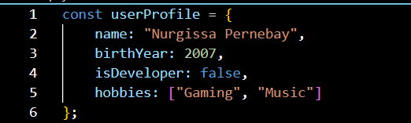
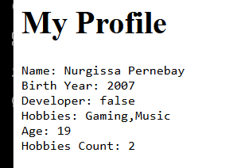
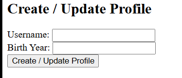
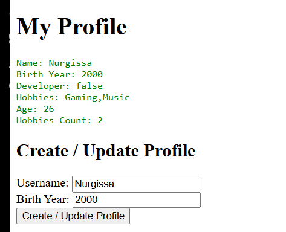
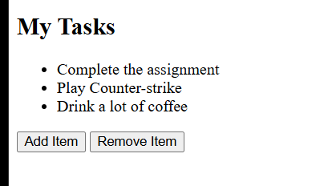
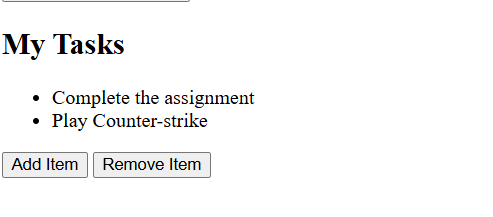

# Assignment 5. JavaScript Basics

Name: Nurgissa Pernebay  
Group: SE-2539

## Part 1: Profile Object, Data Types & Arithmetic

### Task 1. The Personal Info Object
I created a `userProfile` object with a name, birth year, developer status, and hobbies.

### Task 2. Arithmetic Calculations
I calculated the age using the current year and counted the hobbies. I displayed the results on the page and in the console.

## Part 2: Form Input & Event Responses

### Task 3. HTML Form Setup
I created inputs for username and birth year and a submit button.

### Task 4. Event Listener
I added a submit event listener to update the name and birth year in `userProfile` and display the updated information.

## Part 3: DOM List Manipulation

### Task 5. Creating & Removing Elements
I created a task list. The Add Item button adds a new item, and the Remove Item button removes the last item.

Added an item:

Removed the last item:

## Summary
First, I created a profile object and displayed its information. Then I added a form to update the profile and buttons to add and remove list items.
